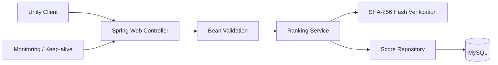

# Tap Blast Ranking Server

모바일 하이퍼캐주얼 게임 **Tap Blast: Drop & Merge**의 글로벌 랭킹 서버입니다. Unity 클라이언트가 제출한 점수를 검증하고, 사용자별 최고 점수를 MySQL에 저장하며 Top 50과 개인 순위를 제공하는 Spring Boot REST API입니다.

---

## 주요 기능

- UUID 기반 사용자별 점수 저장 및 upsert
- 기존 점수보다 높은 점수만 갱신하고 낮거나 같은 점수는 유지
- SHA-256 서명 검증을 통한 점수 변조 탐지
- 점수 내림차순 Top 50 조회
- 개인 점수와 순위 조회
- 닉네임 변경 및 요청 입력값 검증
- 애플리케이션·데이터베이스 상태 확인용 헬스체크
- systemd 기반 Ubuntu 운영 배포 및 장애 시 자동 재시작

---

## 기술 스택

| 구분 | 기술 |
|---|---|
| Language | Java 17 |
| Framework | Spring Boot 4.0.2 |
| Build | Gradle Wrapper 9.3.0 |
| Persistence | Spring Data JPA / Hibernate |
| Database | MySQL 8.x 권장 |
| Validation | Jakarta Bean Validation |
| Test | JUnit 5, Spring Boot Test, AssertJ |
| Deployment | OCI Ubuntu, systemd |
| API | Layered Architecture, Spring Web REST API |

---

## 아키텍처



애플리케이션은 Controller-Service-Repository 계층으로 구성됩니다. 영속성 Entity를 API에 직접 노출하지 않고 DTO로 변환해 외부 응답 계약과 내부 데이터 모델을 분리합니다.

```text
src/
├─ main/java/com/pd/rankingserver/
│  ├─ controller/   # HTTP 엔드포인트
│  ├─ service/      # 점수 검증·upsert·순위 계산
│  ├─ repository/   # Spring Data JPA 저장소
│  ├─ domain/       # Score 엔티티
│  ├─ dto/          # 요청·응답 DTO
│  └─ scheduler/    # OCI keep-alive 작업
├─ main/resources/
│  └─ application.yml
└─ test/
   ├─ RankingServerApplicationTests.java
   └─ service/RankingServiceTest.java
```

### 점수 등록 및 갱신 흐름

```text
Unity 클라이언트
  -> POST /api/rankings
  -> ScoreRequestDto 매핑 및 @Valid 검증
  -> SHA-256 해시 검증
  -> UUID 기반 기존 데이터 조회
  -> 신규 INSERT 또는 최고 점수만 UPDATE
  -> MySQL Score 테이블 적재
  -> ScoreResponseDto(uuid, name, score) 반환
```

### Top 50 조회 흐름

```text
Unity 클라이언트
  -> GET /api/rankings
  -> score 내림차순 Top 50 조회
  -> RankingResponseDto(name, score) 변환
  -> 내부 id와 uuid를 제외한 공개 응답 반환
```

---

## 요구 사항

- JDK 17
- MySQL 및 접근 가능한 데이터베이스
- Windows에서는 `gradlew.bat`, Linux/macOS에서는 `./gradlew` 사용

Gradle과 의존성은 Wrapper가 관리하므로 별도의 Gradle 설치는 필요하지 않습니다.

---

## 환경 변수

운영 비밀값은 저장소에 커밋하지 않고 환경 변수로 주입합니다.

| 변수 | 설명 | 예시 |
|---|---|---|
| `DB_URL` | MySQL JDBC 연결 URL | `jdbc:mysql://localhost:3306/ranking_game?serverTimezone=Asia/Seoul&characterEncoding=UTF-8` |
| `DB_USERNAME` | 데이터베이스 사용자 | `ranking_app` |
| `DB_PASSWORD` | 데이터베이스 비밀번호 | 로컬 또는 운영 비밀값 |
| `RANKING_SECRET` | 클라이언트와 공유하는 점수 서명 비밀값 | 안전한 랜덤 문자열 |

---

## 로컬 실행

### Windows PowerShell

```powershell
$env:DB_URL="jdbc:mysql://localhost:3306/ranking_game?serverTimezone=Asia/Seoul&characterEncoding=UTF-8"
$env:DB_USERNAME="ranking_app"
$env:DB_PASSWORD="your_password"
$env:RANKING_SECRET="your_secret"
.\gradlew.bat bootRun
```

### Linux/macOS

```bash
export DB_URL='jdbc:mysql://localhost:3306/ranking_game?serverTimezone=Asia/Seoul&characterEncoding=UTF-8'
export DB_USERNAME='ranking_app'
export DB_PASSWORD='your_password'
export RANKING_SECRET='your_secret'
./gradlew bootRun
```

기본 서버 주소는 `http://localhost:8080`입니다. `src/main/resources/application.yml`에서 다음 동작을 확인할 수 있습니다.

- `spring.jpa.hibernate.ddl-auto: update`
- SQL 출력 및 포맷팅 활성화
- keep-alive 스케줄러 기본 활성화
- keep-alive 기본 실행 시각: 매일 KST 04:00

`ddl-auto: update`는 개발 환경에서는 편리하지만, 운영 환경에서는 스키마 변경 이력을 관리할 수 있도록 Flyway 또는 Liquibase 도입을 검토해야 합니다.

---

## 빌드 및 테스트

Linux/macOS:

```bash
./gradlew clean build
./gradlew test
```

Windows:

```powershell
.\gradlew.bat clean build
.\gradlew.bat test
```

테스트 코드는 다음 동작을 검증합니다.

- Spring Boot 애플리케이션 컨텍스트 로딩
- 신규 사용자 점수 등록
- 기존 사용자 최고 점수 갱신
- 낮은 점수 제출 시 기존 최고 점수 유지

---

## API 명세

Base URL: `http://localhost:8080/api`

| Method | Endpoint | 설명 | 성공 응답 | 주요 오류 |
|---|---|---|---|---|
| GET | `/health` | 클라이언트용 단순 헬스체크 | `200 OK`, `"ok"` | - |
| GET | `/health/detailed` | 애플리케이션·DB·버전 상태 | `200 OK`, JSON | DB 상태는 `DOWN`으로 표시 |
| POST | `/rankings` | 점수 등록 또는 최고 점수 갱신 | `200 OK`, `ScoreResponseDto` | `400 Bad Request` |
| GET | `/rankings` | 점수 내림차순 Top 50 | `200 OK`, 배열 | - |
| GET | `/rankings/{uuid}` | 개인 점수 및 순위 | `200 OK`, `MyRankResponseDto` | `404 Not Found` |
| PATCH | `/rankings/{uuid}/name` | 닉네임 변경 | `200 OK` | `400 Bad Request`, `404 Not Found` |

### 점수 등록

```http
POST /api/rankings
Content-Type: application/json
```

```json
{
  "uuid": "550e8400-e29b-41d4-a716-446655440000",
  "name": "Player",
  "score": 12345,
  "hash": "calculated-sha256-value"
}
```

요청 필드는 다음 규칙으로 검증합니다.

- `uuid`: UUID 형식
- `name`: 필수, 최대 50자
- `score`: 필수, 0 이상
- `hash`: 필수

클라이언트와 서버는 다음 문자열을 동일하게 구성한 뒤 SHA-256으로 해시합니다.

```text
name:score:uuid:RANKING_SECRET
```

예를 들어 `Player`, `12345`, UUID, secret을 사용하면 다음 순서로 서명합니다.

```text
SHA-256("Player:12345:550e8400-e29b-41d4-a716-446655440000:<RANKING_SECRET>")
```

검증에 실패한 요청은 저장하지 않고 `400 Bad Request`를 반환합니다.

응답 예시:

```json
{
  "uuid": "550e8400-e29b-41d4-a716-446655440000",
  "name": "Player",
  "score": 12345
}
```

### Top 50 조회

```bash
curl http://localhost:8080/api/rankings
```

```json
[
  {
    "name": "Player",
    "score": 12345
  }
]
```

응답에는 공개에 필요하지 않은 내부 `id`와 `uuid`를 포함하지 않습니다.

### 개인 순위 조회

```bash
curl http://localhost:8080/api/rankings/550e8400-e29b-41d4-a716-446655440000
```

개인 순위는 자신의 점수보다 높은 레코드 수에 1을 더해 계산합니다. 따라서 동일 점수 사용자는 동일한 순위 값을 가질 수 있습니다.

### 닉네임 변경

```http
PATCH /api/rankings/550e8400-e29b-41d4-a716-446655440000/name
Content-Type: application/json
```

```json
{
  "name": "NewName"
}
```

존재하지 않는 UUID는 `404 Not Found`, 빈 문자열이나 50자를 초과하는 이름은 `400 Bad Request`입니다.

### 헬스체크

```bash
curl -i http://localhost:8080/api/health
curl http://localhost:8080/api/health/detailed
```

상세 헬스체크는 다음 정보를 제공합니다.

```json
{
  "status": "UP",
  "db": "UP",
  "checkedAt": "2026-11-11T01:00:00Z",
  "version": "0.0.1-SNAPSHOT"
}
```

`/api/health`의 기존 평문 응답은 게임 클라이언트와 keep-alive 호출 호환성을 위해 유지하고, 운영 모니터링에는 `/api/health/detailed`를 사용합니다.

---

## 데이터 모델

`Score` Entity는 다음 제약조건과 인덱스를 사용합니다.

| 컬럼 | 타입 | 제약 | 설명 |
|---|---|---|---|
| `id` | BIGINT | PK, Auto Increment | 레코드 내부 식별자 |
| `uuid` | VARCHAR(36) | UNIQUE, NOT NULL | 클라이언트 디바이스 식별자 |
| `name` | VARCHAR(50) | NOT NULL | 사용자 닉네임 |
| `score` | INT | NOT NULL, B-Tree Index | 랭킹 점수 |

`uuid`에는 unique 제약을 적용해 사용자별 단일 레코드를 보장하고, `score`에는 `idx_score_score` 인덱스를 적용해 Top 50 정렬 및 순위 관련 조회를 최적화할 수 있도록 했습니다.

---

## 운영 배포

Ubuntu systemd 배포 파일과 전체 설치·검증 절차는 [`deploy/README.md`](./deploy/README.md)를 참고하세요.

```bash
sudo cp deploy/ranking-server.env.example /etc/ranking-server.env
sudo chmod 600 /etc/ranking-server.env
sudo cp deploy/ranking-server.service /etc/systemd/system/ranking-server.service
sudo systemctl daemon-reload
sudo systemctl enable --now ranking-server
sudo systemctl status ranking-server --no-pager
```

운영 로그는 journald에서 확인합니다.

```bash
sudo journalctl -u ranking-server -f
```

운영 환경에서는 다음 원칙을 지킵니다.

- `/etc/ranking-server.env`는 `root:root`, 권한 `600`으로 유지
- 데이터베이스 비밀번호와 `RANKING_SECRET`은 Git에 커밋하지 않음
- 새 JAR 배포 후 `systemctl restart ranking-server`로 재기동
- 배포 후 `/api/health`와 `/api/health/detailed`로 서비스·DB 상태 확인

---

## 주요 개선 및 트러블슈팅

### DB 스키마와 Entity 제약조건 동기화

DB 컬럼 제약조건과 JPA Entity 설정이 불일치하면 길이 초과나 `NULL` 데이터로 인한 데이터 오염이 발생할 수 있습니다. 이를 방지하기 위해 `Score` Entity에 다음 제약조건을 명시했습니다.

- `uuid`: 길이 36, unique, not null
- `name`: 최대 50자, not null
- `score`: not null
- `score` 컬럼: `idx_score_score` 인덱스

### API 입력 검증 및 예외 응답 표준화

점수 등록과 닉네임 변경 API에 Bean Validation을 적용해 잘못된 입력을 저장 계층에 전달하기 전에 차단했습니다. 특히 PATCH API에는 `@Valid`, `@NotBlank`, `@Size(max = 50)`을 적용했으며, 존재하지 않는 UUID는 `404 Not Found`로 응답하도록 표준화했습니다.

### DTO 분리와 공개 응답 최소화

DTO를 `com.pd.rankingserver.dto` 패키지로 분리하고, Entity를 API 응답에 직접 사용하지 않도록 했습니다. Top 50 응답은 공개에 필요한 `name`, `score`만 반환해 내부 DB ID와 UUID가 불필요하게 노출되지 않도록 설계했습니다.

### 조회 성능 최적화

단순한 `ORDER BY score DESC` 조회는 데이터 증가에 따라 정렬 비용이 커질 수 있습니다. `score` 컬럼에 B-Tree 인덱스 `idx_score_score`를 선언해 Top 50 정렬과 범위 조회에서 인덱스를 활용할 수 있는 기반을 마련했습니다.

### 운영 프로세스 안정화

기존 SSH 세션 기반 `nohup java -jar` 실행 방식은 재부팅 후 자동 시작이 어렵고, 프로세스 장애·로그·비밀값 관리가 분산되는 문제가 있었습니다. 이를 systemd로 전환해 다음을 개선했습니다.

- 서버 재부팅 시 자동 시작
- 비정상 종료 시 자동 재시작
- journald 기반 로그 일원화
- `/etc/ranking-server.env`를 통한 비밀값 분리
- `NoNewPrivileges`, `PrivateTmp` 등 기본적인 서비스 격리

---

## 운영 메모 및 향후 개선

- 애플리케이션 내부 keep-alive 스케줄러는 기본적으로 매일 KST 04:00에 실행됩니다. 외부 모니터링과 함께 OCI Always Free 인스턴스의 idle 회수에 대비하는 보조 수단입니다.
- `RANKING_SECRET`은 클라이언트와 공유되므로 secret 변경 시 Unity 클라이언트 설정도 함께 변경해야 점수 등록이 정상 동작합니다.
- `ddl-auto: update`는 개발 환경에는 적합하지만 정식 운영에서는 Flyway 또는 Liquibase 기반 마이그레이션으로 전환할 필요가 있습니다.
- 동시 접속과 조회량이 증가하면 Redis Sorted Set(ZSET)을 읽기 모델로 도입하는 CQRS 구조를 검토할 수 있습니다.
- MySQL 8.0의 `RANK()` 윈도우 함수와 `EXPLAIN`을 활용해 동점자 처리 및 개인 순위 조회 쿼리를 개선할 수 있습니다.

---

## 관련 프로젝트

- [Tap-Blast-Drop-Merge](https://github.com/romantic02/Tap-Blast-Drop-Merge) — Unity 게임 클라이언트

---

## 라이선스

현재 저장소에는 별도의 `LICENSE` 파일이 없습니다. 외부 공개 또는 재사용을 허용할 계획이라면 프로젝트 정책에 맞는 라이선스 파일을 추가하고 이 섹션을 갱신해야 합니다.
